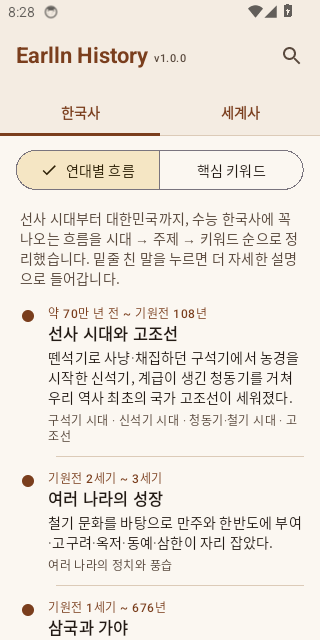
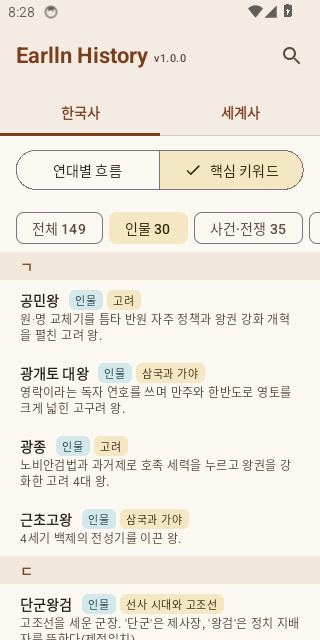
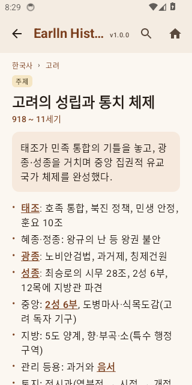
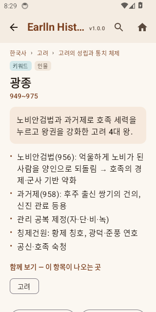

# Earlln History

한국사 · 세계사 핵심 요약 안드로이드 앱. 수능 수준의 내용을 **시대 → 주제 → 키워드** 순으로 내려가며 볼 수 있습니다.

## 설치

[Releases](https://github.com/earlln/earlln-history/releases) 에서 최신 `EarllnHistory-v*.apk` 를 휴대폰으로 내려받아 설치합니다.
(설정에서 "출처를 알 수 없는 앱 설치"를 허용해야 합니다. 지금은 CI 디버그 서명이라 새 버전을 깔 때 기존 앱을 지우고 설치해야 할 수 있습니다.)

## 화면

| 연대별 흐름 | 핵심 키워드 | 주제 | 키워드 |
|---|---|---|---|
|  |  |  |  |

- **홈** — 한국사 / 세계사 탭, 그 안에서 두 가지 보기
  - **연대별 흐름**: 시대마다 한 줄 요약과 주요 주제 (가장 간단한 필수 흐름)
  - **핵심 키워드**: 시대와 상관없이 키워드만 모아 분류(인물·사건·제도·문화 …) 칩과 가나다 초성으로 정리
- **세부 화면** — 위치(한국사 › 고려 › 무신 정권), 요약, 본문, 아래 단계 목록, "함께 보기"(이 항목을 언급한 곳), 이전/다음
- 본문 속 **밑줄 친 키워드는 모두 링크** — 누르면 그 항목으로 들어가고, 뒤로 가기로 돌아옵니다
- **밑줄 없는 낱말도 누르면 구글 검색**으로 넘어갑니다 (세부 화면의 제목·요약·본문, 홈 머리말). 조사는 떼고 검색합니다 — 예: "호족을" → `호족`
- 검색, 상단의 작은 버전 표시

## 내용 고치기

내용은 `content/korean/*.txt`, `content/world/*.txt` 원고에 있습니다. 형식은 [`tools/build_content.py`](tools/build_content.py) 첫머리 설명을 보세요.

```
@topic k_t_goryeo_early | 고려의 성립과 통치 체제 | 918 ~ 11세기
요약 한두 문장
---
- 본문. [[k_gwangjong|광종]] 처럼 쓰면 링크가 됩니다
@key k_gwangjong | 광종 | 인물 | 949~975
요약
---
본문
```

```bash
python tools/build_content.py          # 원고 → app/src/main/assets/history.json (깨진 링크 검사 포함)
```

## 빌드

동작 확인: Actions 의 **Smoke test (emulator)** 를 수동 실행하면 에뮬레이터에서 앱을 띄워 주요 화면을 캡처합니다(`tools/smoke.sh`).


`main` 에 push 하면 GitHub Actions 가 원고 검사 → APK 빌드 → `v{versionName}` 릴리스에 APK 를 올립니다.
버전은 `app/build.gradle.kts` 의 `versionName` / `versionCode` 를 올리면 새 릴리스가 생깁니다.

로컬: JDK 17 + Android SDK + Gradle 8.9 로 `gradle assembleDebug` (Android Studio 로 열어도 됩니다).

- Kotlin · Jetpack Compose (Material 3), minSdk 26
- 외부 라이브러리 없이 `assets/history.json` 만 읽습니다
